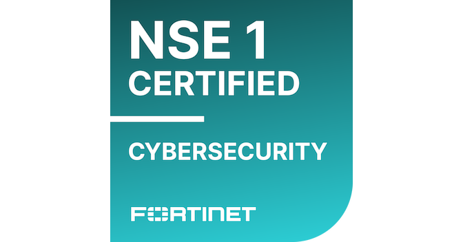

# Lilia Elba Martínez Rosas

**NOC/SOC Analyst | Cybersecurity | Biomedical Engineer**
Orizaba, Veracruz, Mexico (UTC-6) · Remote · Any shift, nights and weekends included
Website: [lili-martinez.vercel.app](https://lili-martinez.vercel.app) · Resume: [cv.pdf](https://lili-martinez.vercel.app/files/cv.pdf)

I'm a biomedical engineer moving into IT and cybersecurity operations. I've fixed surgical equipment during live spine and neurosurgical procedures, spent two years on component-level electronics repair, formatting computers and installing firewalls, and ran my own rental business for almost three years, where I turned recurring guest issues into clear written procedures. Different worlds, same job: spot the problem early and fix it fast, but with precision.

Calm, methodical and focused on patterns. I communicate clearly in English and Spanish, and I'm now applying that approach to security monitoring and IT operations.

**Identify, confirm, fix, test.** I document each step so it can be replicated and analyzed.

---

## Certifications

**Fortinet NSE 1 Certified in Cybersecurity**, Fortinet · October 2026
Entry-level cybersecurity: today's threat landscape and security fundamentals.
[Verify on Credly](https://www.credly.com/badges/a973b8c5-67dd-4f4c-ba7e-6d4f5334fad8/public_url)

## Right now

- Growing my SOC home lab: Wazuh alert triage, Splunk SPL investigations, Nmap recon and network segmentation design
- Next up: CompTIA Security+

## Projects

**[SOC Home Lab](https://github.com/liliaem/soc-home-lab)**: my documented lab work. Wazuh v4.14.8 on an Ubuntu Server 24.04.5 LTS VM, Splunk Cloud (trial), Hydra and Nmap. Reports are sanitized (IPs, MACs, identifiers) before publishing.

### Triage reports

| ID | Title | Summary |
| --- | --- | --- |
| [TR-001](https://github.com/liliaem/soc-home-lab/blob/main/0.3%20Triage%20reports/TR-001%20SSH%20brute%20force%20invalid%20user.md) | SSH Brute Force | Triaged Wazuh rule 5710 alerts (failed SSH logins, non-existent user), pivoted on the source IP to confirm no successful login, mapped to MITRE ATT&CK T1110.001. Verdict: benign true positive. |
| [TR-002](https://github.com/liliaem/soc-home-lab/blob/main/0.3%20Triage%20reports/TR-002%20Failed%20SSH%20Logins%20-%20Splunk%20vs%20Wazuh.md) | Failed SSH Logins: Splunk vs Wazuh | Ran an authorized Hydra attack, investigated it in Splunk with SPL (`rex`, `stats`, `where` threshold), ruled out false positives, mapped to T1110.001 and compared detection in Splunk vs Wazuh. |

### Network assessments

| ID | Title | Summary |
| --- | --- | --- |
| [NA-001](https://github.com/liliaem/soc-home-lab/blob/main/0.4%20Network%20assessments/NA-001%20Household%20Network%20Segmentation.md) | Network Segmentation | Assessed a flat home network and designed a VLAN plan with default-deny firewall policies. Implementation blocked by the ISP-managed gateway; enabled the host firewall instead. |
| [NA-002](https://github.com/liliaem/soc-home-lab/blob/main/0.4%20Network%20assessments/NA-002%20Network%20recon%20with%20Nmap.md) | Network Recon with Nmap | Built an asset inventory, scanned for open ports and services, and prioritized risks by severity and owner. *In progress.* |

**[Personal website](https://lili-martinez.vercel.app)**: built with Next.js, TypeScript, Tailwind, and shadcn/ui, deployed on Vercel.

## Side projects

**[MeetBible](https://www.meetbible.faith/):** my hobby web project. Software isn't my career path, but I love building things. I also designed its penguin mascot.

## Skills

- **Security:** Wazuh (SIEM), Splunk Cloud (SPL), Hydra, Nmap, MITRE ATT&CK mapping, alert triage, false-positive analysis, Linux log analysis (auth.log), attack surface and risk prioritization, incident documentation, network segmentation (VLANs, default deny), Fortinet NSE 1
- **Systems:** Windows and Linux setup and configuration, firewall setup, SSH, macOS (zsh, Homebrew), bash
- **Code:** Python, JavaScript, TypeScript, Next.js, HTML/CSS, MATLAB/Octave, Git/GitHub, LaTeX
- **Analysis:** root-cause analysis, pattern recognition, clear written documentation
- **Automation & productivity:** Zapier, AI-assisted workflows (Claude, ChatGPT, Gemini), Notion, Obsidian, Excel, Google Workspace
- **Hardware:** component-level diagnostics, SMD micro-soldering, EEPROM programming, thermal imaging, medical equipment maintenance

## Experience

- **Property Operations Manager**, my own short-term rental business · Jul 2023 – Feb 2026
- **Freelance Electronics Technician** · Jan 2020 – Apr 2022
- **Surgical Technology Specialist**, Neuroquirúrgica Integral · 2019
- **Research Project**, UAM Iztapalapa / SERME clinic · 2017 – 2018

## Education

- **B.S. Biomedical Engineering**, Universidad Autónoma Metropolitana (UAM) · 2013 – 2018
- Published at IEEE EMBC 2018: _Latency and amplitude changes in cognitive event related potentials due to hemodialysis_ · [DOI: 10.1109/EMBC.2018.8512612](https://pubmed.ncbi.nlm.nih.gov/30440814/)

## Languages

Spanish (native) · English (fluent) · French (basic)

## Contact

[lili-martinez.vercel.app](https://lili-martinez.vercel.app) · [liliaelba123@gmail.com](mailto:liliaelba123@gmail.com) · [GitHub: soc-home-lab](https://github.com/liliaem/soc-home-lab)
