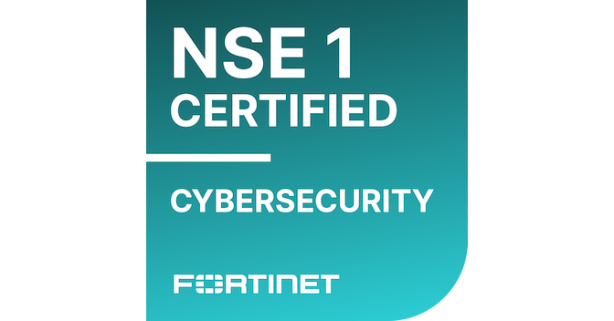

# Lilia Elba Martínez Rosas

**Technical Support | Security Operations | Biomedical Engineer | Hardware & Software**
Mexico (UTC-6) · Remote or on-site · Any shift, nights, holidays and weekends included
Website: [lili-martinez.vercel.app](https://lili-martinez.vercel.app) · Resume: [cv.pdf](https://lili-martinez.vercel.app/files/cv.pdf)

Engineer driven by curiosity, with a habit of tracing every problem back to its root cause. I investigate issues, isolate the
cause, and document the fix so it doesn’t happen again. I apply that approach in my own home lab (Wazuh and Splunk Enterprise), with every investigation documented on GitHub. Years of customer-facing work have made me a patient,
clear communicator with non-technical people, in English and Spanish. Calm, methodical and focused on patterns.

**Identify, confirm, fix, test.** I document each step so it can be replicated and analyzed.

---

## Certifications

**Fortinet NSE 1 Certified in Cybersecurity**, Fortinet · October 2026
Entry-level cybersecurity: today's threat landscape and security fundamentals.
[Verify on Credly](https://www.credly.com/badges/a973b8c5-67dd-4f4c-ba7e-6d4f5334fad8/public_url)

## Right now

- Writing detection rules as code (Sigma) with Python and validating them in my own Splunk
- Studying for Microsoft SC-900, then SC-200

## Projects

**[SOC Home Lab](https://github.com/liliaem/soc-home-lab)**: my documented lab work. Wazuh on an Ubuntu Server VM (UTM), Splunk Enterprise in Docker, Hydra, Nmap, and Python. Reports are sanitized (IPs, MACs, identifiers) before publishing.

### Triage reports

| ID | Title | Summary |
| --- | --- | --- |
| [TR-001](https://github.com/liliaem/soc-home-lab/blob/main/0.3%20Triage%20reports/TR-001%20SSH%20brute%20force%20invalid%20user.md) | SSH Brute Force | Triaged Wazuh rule 5710 alerts (failed SSH logins, non-existent user), pivoted on the source IP to confirm no successful login, mapped to MITRE ATT&CK T1110.001. Verdict: benign true positive. |
| [TR-002](https://github.com/liliaem/soc-home-lab/blob/main/0.3%20Triage%20reports/TR-002%20Failed%20SSH%20Logins%20-%20Splunk%20vs%20Wazuh.md) | Failed SSH Logins: Splunk vs Wazuh | Ran an authorized Hydra attack, investigated it in Splunk with SPL (`rex`, `stats`, `where` threshold), ruled out false positives, mapped to T1110.001 and compared detection in Splunk vs Wazuh. |
| [TR-003](https://github.com/liliaem/soc-home-lab/blob/main/0.3%20Triage%20reports/TR-003%20SPL%20queries%20to%20investigate%20an%20SSH%20brute%20force%20attack%20in%20Splunk%27s%20generated%20data.md) | SSH Brute Force in Splunk | Investigated failed SSH logins across 100,000+ events in Splunk Enterprise (Docker) with SPL to determine whether any attacker gained access. |

### Detection engineering
 
| ID | Title | Summary |
| --- | --- | --- |
| [DE-001](https://github.com/liliaem/soc-home-lab/blob/main/0.6%20Detection%20Engineering/DE-001%20Writing%20a%20Sigma%20detection%2C%20converting%20it%20to%20SPL%20and%20validating%20it%20with%20TR-003.md) | Sigma Rule to SPL | Wrote a Sigma rule for failed SSH passwords, converted it to SPL with pySigma, and validated it against the TR-003 baseline (33,253 matching events). |

### Application security
 
| ID | Title | Summary |
| --- | --- | --- |
| [AS-001](https://github.com/liliaem/soc-home-lab/blob/main/0.5%20Application%20Security/AS%20-%20001%20Dependency%20Vulnerability%20Triage%20%7C%20Fixed%20a%20critical%20Next.js%20CVE%2C%20reduced%2019%20%E2%86%92%2011%20vulns%2C%20accepted%20dev-tooling%20residual%20risk..md) | Dependency Vulnerability Triage | Fixed a critical Next.js CVE, reduced vulnerabilities from 19 to 11, and documented the accepted residual risk in dev tooling. |
| [AS-002](https://github.com/liliaem/soc-home-lab/blob/main/0.5%20Application%20Security/AS%20-%20002%20HTTP%20security%20headers%20and%20Content%20Security%20Policy%20on%20a%20Next.js%20website.md) | Security Headers and CSP | Added four HTTP security headers and a Content Security Policy to a public Next.js website, verified each in staging and production, and documented the trade-offs. |

### Network assessments

| ID | Title | Summary |
| --- | --- | --- |
| [NA-001](https://github.com/liliaem/soc-home-lab/blob/main/0.4%20Network%20assessments/NA-001%20Household%20Network%20Segmentation.md) | Network Segmentation | Assessed a flat home network and designed a VLAN plan with default-deny firewall policies. Implementation blocked by the ISP-managed gateway; enabled the host firewall instead. |
| [NA-002](https://github.com/liliaem/soc-home-lab/blob/main/0.4%20Network%20assessments/NA-002%20Network%20recon%20with%20Nmap.md) | Network Recon with Nmap | Built an asset inventory, scanned for open ports and services, and prioritized risks by severity and owner. *In progress.* |

## 0.7 Cloud Security (Microsoft Azure)
| ID     | Title                                               | Skills                                               |
| ------ | --------------------------------------------------- | ---------------------------------------------------- |
| [CS-001](https://github.com/liliaem/soc-home-lab/blob/main/0.7%20Cloud%20Security/CS-001%20%20Entra%20ID%20least%20privilege%20and%20access%20troubleshooting.md)  | Entra ID least privilege and access troubleshooting | Entra ID, Azure RBAC, sign-in and audit log analysis |

**[Personal website](https://lili-martinez.vercel.app)**: built with Next.js, TypeScript, and Tailwind, deployed on Vercel. Includes a live IP reputation checker using the AbuseIPDB REST API, with visits logged in PostgreSQL.

## Side projects

**[MeetBible](https://www.meetbible.faith/):** my hobby web project, built with Next.js. I also designed its penguin mascot in CSS.

## Skills
 
- **Hardware:** component-level diagnostics, SMD micro-soldering, EEPROM programming, thermal imaging, oscilloscope, medical equipment preventive maintenance
- **Systems:** Windows, Linux and macOS setup and configuration, firewall setup, SSH, bash, zsh, Docker, virtual machines (UTM)
- **Security:** Wazuh (SIEM), Splunk (SPL), Sigma, MITRE ATT&CK mapping, alert triage, false-positive analysis, Linux log analysis, HTTP security headers and CSP, dependency vulnerability triage, network segmentation, Fortinet NSE 1
- **Code & APIs:** Python, JavaScript, TypeScript, Next.js, HTML/CSS, REST APIs, cURL, JSON, PostgreSQL, Git/GitHub, MATLAB/Octave, LaTeX
- **Analysis:** root-cause analysis, pattern recognition, clear written documentation
- **Automation & productivity:** Zapier, AI-assisted workflows (Claude, ChatGPT, Gemini), Notion, Obsidian, Excel, Google Workspace, Microsoft 365

## Experience

- **Short-Term Rental Operations Manager**, Jul 2023 – Feb 2026
- **Freelance Electronics Technician**, 2020 - 2022
- **Medical Device Support**, 2019
- **Research Project**, 2017 – 2018

## Education

- **B.S. Biomedical Engineering**, Universidad Autónoma Metropolitana (UAM), 2018
- Published at IEEE EMBC 2018: _Latency and amplitude changes in cognitive event related potentials due to hemodialysis_ · [DOI: 10.1109/EMBC.2018.8512612](https://pubmed.ncbi.nlm.nih.gov/30440814/)

## Languages

Spanish (native) · English (fluent) · French (basic)

## Contact

[lili-martinez.vercel.app](https://lili-martinez.vercel.app)  · [GitHub: soc-home-lab](https://github.com/liliaem/soc-home-lab)
